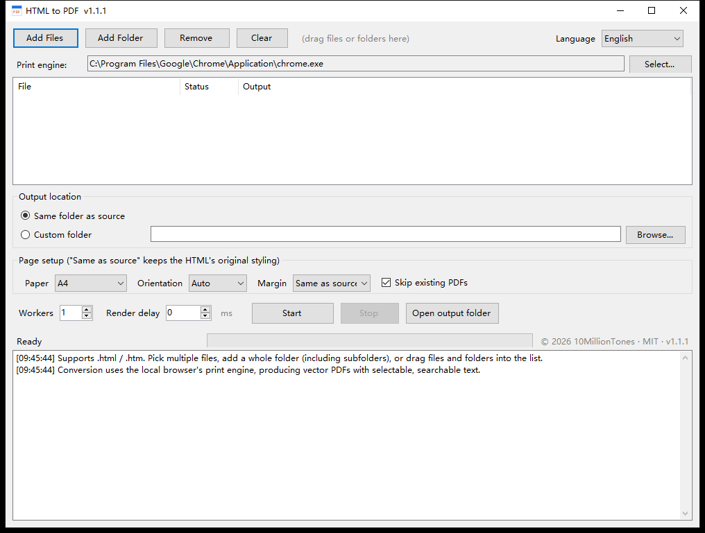

# HTML2PDF

A small Windows tool that batch-converts local HTML files to PDF. One 53 KB exe, no installation, drop files in and click a button.

[中文](README.md) | **English** | [日本語](README.ja.md) | [한국어](README.ko.md)




## What it is for

You have a pile of exported HTML reports, e-invoices or offline docs and need them all as PDF. Opening each one and hitting Ctrl+P is slow, and PDFs stitched together from screenshots are blurry and not searchable.

This tool drives the print engine already inside your Chrome or Edge install and outputs **vector PDFs** — text stays selectable and searchable, and the layout matches what you see in the browser.

## Features

- Add single files or whole folders; `.html` / `.htm` are picked up recursively
- Vector PDF output with embedded font subsets, text stays selectable and searchable
- UI switches live between 中文 / English / 日本語 / 한국어, and your choice is remembered
- Paper: same as source, A4, A3, A5, Letter, Legal; portrait or landscape; six margin steps
- Workers adjustable from 1 to 4, default 1
- Optional "skip existing PDFs" and "include subfolders"
- Non-ASCII paths handled; duplicate output names get a `(2)` suffix automatically
- Each PDF is written to a temp file first, so a failed run never leaves a half-written file
- Every run uses its own temporary browser profile and never touches the browser you are using
- All temporary files are cleaned up when the run finishes

## Download

Grab `HTML2PDF.exe` from [Releases](https://github.com/10MillionTones/HTML2PDF/releases/latest) and double-click it. No installer.

## How to use

### 1. Add files

Any of these:

- Click "Add Files" or "Add Folder"
- Drag files or folders into the window
- Drop files onto the exe icon

Whether subfolders are included depends on the folder option.

### 2. Pick a print engine

The app auto-detects Chrome first, then Edge, and shows the path next to "Print engine". If nothing is found, or you want a different browser, click "Select..." and choose `chrome.exe` / `msedge.exe`.

### 3. Choose where PDFs go

- **Same folder as source**: default, each PDF sits next to its HTML
- **Custom folder**: every PDF goes into one folder

### 4. Page setup

| Option | Notes |
|---|---|
| Paper | Defaults to A4. Headless Chrome defaults to Letter, so this matters |
| Orientation | Auto / portrait / landscape |
| Margin | Same as source, 0, 5, 10, 15, 20, 25 mm |
| Skip existing PDFs | On by default; turn off to overwrite |

When a specific paper size is chosen, the app writes a temporary copy of the HTML next to the original with an `@page` rule injected, then deletes it right after conversion. That keeps relative images and stylesheets working.

### 5. Run settings

| Option | Default | Notes |
|---|---|---|
| Workers | 1 | How many browser instances run at once. Keep it at 1 on low-memory machines |
| Render delay | 0 ms | Only needed when the page fills itself in with JavaScript, e.g. 2000 |

### 6. Convert

Click "Start". Status updates per file in the list, and the progress bar plus log follow along. You can hit "Stop" at any time; finished files are kept.

### 7. Switch language

The dropdown in the top-right corner switches between Chinese, English, Japanese and Korean at any time. Labels, column headers, log lines and dialogs all change with it, and the choice persists on the next launch.

## FAQ

**The PDF is blank**

The page probably renders its content after an async request. Set "Render delay" to 2000 or 3000 ms and try again.

**It says "the browser did not produce a PDF"**

The text in brackets is what the browser itself printed. Three common causes: a page script blocks printing, the output folder is read-only, or security software intercepted the process. Try saving to another folder such as the Desktop. `Access is denied` in the log means a permission problem; anything mentioning `headless` means a browser version problem.

**Pages that require a login don't convert**

The headless browser starts with a fresh profile and no cookies, so it doesn't inherit your session. Save those pages manually from your browser.

**It says no browser was found**

Install Chrome or Edge, or click "Select..." and point it at the browser executable.

**It crashes or reports no engine on Windows 7**

Chromium 110 dropped Windows 7 support. Use Chrome or Edge 109 or older.

**Antivirus flags the exe**

The exe is not code-signed, so heuristic engines sometimes complain. Whitelist it, or build your own copy with the command below.

**The paper size is wrong**

With "Same as source" the app injects no styling at all, so the page size comes from the HTML's own `@page`. Pick A4 if you want to force it.

## Requirements

| Item | Requirement |
|---|---|
| OS | Windows 7 SP1 / 10 / 11 |
| Architecture | 32-bit and 64-bit (AnyCPU, one exe) |
| Runtime | .NET Framework 4.0 or newer (Windows 10 / 11 ship 4.8) |
| Browser | Chrome or Edge; Windows 7 needs version 109 or older |

## How it works

It calls the browser's headless print mode:

```
chrome.exe --headless --disable-gpu --hide-scrollbars
           --user-data-dir=<temp profile>
           --print-to-pdf=<output>.pdf --no-pdf-header-footer
           "file:///D:/folder/page.html"
```

Internally that goes `HTML → Blink layout → Skia drawing → PDF objects`, so the result is real vector content with font subsets rather than a bitmap screenshot. Paper size and margins are applied by injecting `@page` CSS, because the Chrome command line has no flags for them.

## Project layout

```
HTML2PDF.cs      Main program, single-file WinForms
docs/            UI screenshots in four languages
LICENSE          MIT license
README.md        Chinese
README.en.md     English
README.ja.md     Japanese
README.ko.md     Korean
```

## Build it yourself

All you need is the .NET Framework compiler that ships with Windows:

```powershell
C:\Windows\Microsoft.NET\Framework64\v4.0.30319\csc.exe /target:winexe /platform:anycpu /codepage:65001 `
  /out:HTML2PDF.exe /r:System.dll /r:System.Core.dll /r:System.Drawing.dll /r:System.Windows.Forms.dll `
  HTML2PDF.cs
```

## Version history

| Version | Changes |
|---|---|
| 1.1.1 | Clear failure reasons (browser log, read-only output folder, over-long path); PDFs are written to a temp file first and moved into place; one automatic retry with minimal flags |
| 1.1.0 | UI in Chinese / English / Japanese / Korean; version number shown in the title bar |
| 1.0.0 | First release: batch conversion, page setup, concurrency, log |

## License

[MIT License](LICENSE). Use it, modify it, redistribute it and sell it — just keep the copyright notice.

Copyright (c) 2026 10MillionTones

## Notices

**Copyright**

Copyright (c) 2026 10MillionTones. Under the MIT License you **must keep** the `LICENSE` file and the copyright notice in the source and documentation when you use, modify or redistribute this project. Removing the copyright notice before redistributing violates the license.

**Disclaimer**

The software is provided "as is", without warranty of any kind, express or implied, including but not limited to the warranties of merchantability, fitness for a particular purpose and noninfringement. The author is not liable for any data loss, incorrect output or other damage caused by using this tool. Check the converted files yourself and keep the original HTML for anything important.

**Privacy**

Everything runs locally. The program does not connect to the network and does not collect or upload any data. Temporary files are removed when a run finishes.

**Trademarks**

Chrome is a trademark of Google LLC. Edge and Windows are trademarks of Microsoft Corporation. This project only invokes the browser already installed on your machine and is not affiliated with or endorsed by either company.
