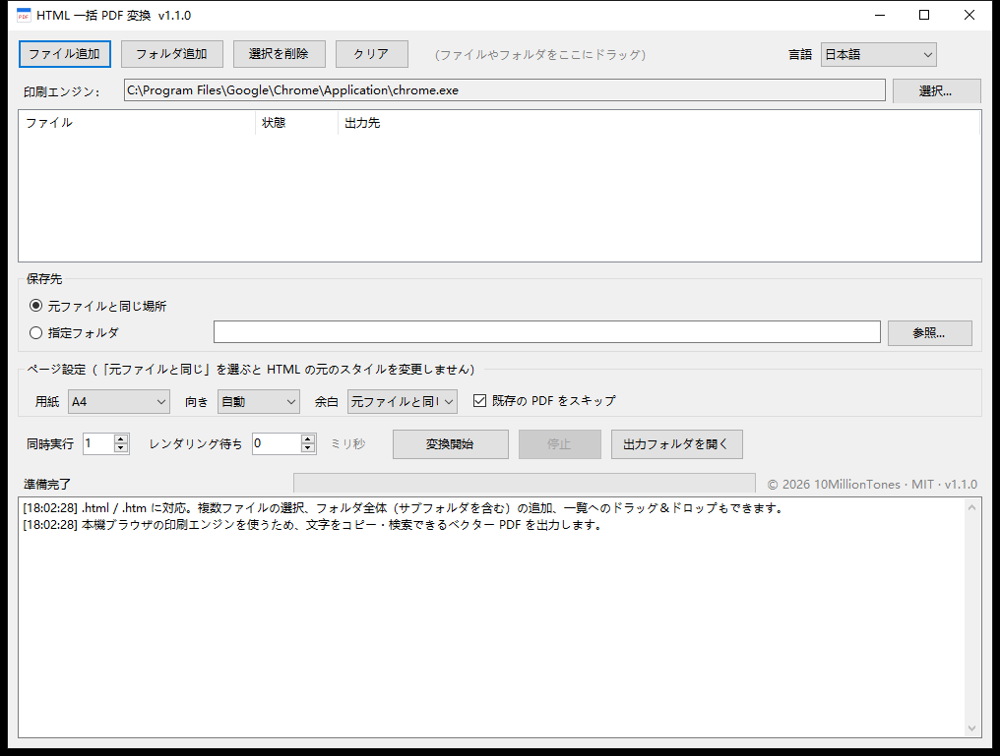

# HTML2PDF

ローカルの HTML ファイルをまとめて PDF に変換する Windows 用ツールです。50 KB の exe ひとつ、インストール不要、放り込んでボタンを押すだけ。

[中文](README.md) | [English](README.en.md) | **日本語** | [한국어](README.ko.md)




## 何のためのツールか

書き出した HTML レポートや電子請求書、オフライン資料が溜まっていて、まとめて PDF にしたい場面。ひとつずつ開いて Ctrl+P を押すのは面倒ですし、スクリーンショットを繋いだ PDF は文字が潰れて検索もできません。

このツールはお使いの Chrome / Edge の印刷エンジンを呼び出し、**ベクター PDF** をまとめて出力します。文字はコピーも検索もでき、レイアウトはブラウザで見たままです。

## 機能

- ファイルでもフォルダでも追加可能。`.html` / `.htm` を再帰的に拾います
- ベクター PDF を出力。フォントはサブセットで埋め込まれ、文字は選択・検索できます
- 画面は 中文 / English / 日本語 / 한국어 をいつでも切り替え可能。選択は次回も保持されます
- 用紙：元ファイルと同じ、A4、A3、A5、Letter、Legal。向きは縦横、余白は 6 段階
- 同時実行は 1〜4、初期値は 1
- 「既存の PDF をスキップ」「サブフォルダを含める」を選択可能
- 日本語や中国語のパスに対応。同名ファイルは `(2)` の連番が付きます
- 出力は一時ファイルに書いてから名前を変更するので、途中で失敗しても中途半端な PDF が残りません
- 変換ごとに専用の一時プロファイルを使うため、普段使っているブラウザには影響しません
- 終了時に一時ファイルをすべて削除します

## ダウンロード

[Releases](https://github.com/10MillionTones/HTML2PDF/releases/latest) から `HTML2PDF.exe` を取得してダブルクリックしてください。インストールは不要です。

## 使い方

### 1. ファイルを追加

次のどれでも構いません。

- 「ファイル追加」「フォルダ追加」を押す
- ファイルやフォルダをウィンドウにドラッグ
- ファイルを exe のアイコンにドロップ

フォルダを追加したとき、サブフォルダまで対象にするかは設定に従います。

### 2. 印刷エンジンを選ぶ

起動時に Chrome、次に Edge の順で自動検出し、「印刷エンジン」にパスを表示します。見つからない場合や別のブラウザを使いたい場合は「選択...」から `chrome.exe` / `msedge.exe` を指定してください。

### 3. 保存先を決める

- **元ファイルと同じ場所**：初期値。各 PDF は HTML の隣にできます
- **指定フォルダ**：すべての PDF を 1 つのフォルダにまとめます

### 4. ページ設定

| 項目 | 説明 |
|---|---|
| 用紙 | 初期値は A4。ヘッドレスブラウザの既定は Letter なので、この指定は意味があります |
| 向き | 自動 / 縦 / 横 |
| 余白 | 元ファイルと同じ、0、5、10、15、20、25 mm |
| 既存の PDF をスキップ | 初期値はオン。オフにすると上書きします |

用紙を指定した場合、HTML と同じフォルダに一時コピーを作り、`@page` ルールを差し込んでから変換し、終わったらすぐ削除します。これで相対パスの画像や CSS もそのまま読み込めます。

### 5. 実行オプション

| 項目 | 初期値 | 説明 |
|---|---|---|
| 同時実行 | 1 | 同時に起動するブラウザの数。メモリが厳しい環境では 1 のままにしてください |
| レンダリング待ち | 0 ミリ秒 | JavaScript で後から内容を描画するページのみ指定します。例：2000 |

### 6. 変換開始

「変換開始」を押すと、一覧の状態が随時更新され、進捗バーとログも連動します。「停止」はいつでも押せます。完了済みのファイルはそのまま残ります。

### 7. 言語の切り替え

右上のドロップダウンで中国語・英語・日本語・韓国語をいつでも切り替えられます。ボタンや列見出し、ログ、ダイアログの文言がまとめて変わり、次回起動時も同じ言語になります。

## よくある質問

**PDF が白紙になる**

内容を非同期のリクエスト後に描画しているページだと思われます。「レンダリング待ち」を 2000〜3000 ミリ秒にして試してください。

**ログインが必要なページが変換できない**

ヘッドレスブラウザは Cookie を持たない新しい環境で動くため、ログイン状態を引き継げません。そうしたページはブラウザから手動で保存してください。

**ブラウザが見つからないと表示される**

Chrome か Edge をインストールするか、「選択...」からブラウザの実行ファイルを指定してください。

**Windows 7 で落ちる、エンジンが使えないと出る**

Chromium 110 以降は Windows 7 に対応していません。Chrome / Edge の 109 以前を入れてください。

**ウイルス対策ソフトに検出される**

exe にデジタル署名がないため、ヒューリスティック検出に引っかかることがあります。除外設定に追加するか、下のコマンドでご自身でビルドしてください。

**用紙サイズが意図と違う**

「元ファイルと同じ」を選ぶとスタイルを一切変更しないため、用紙は HTML 側の `@page` で決まります。A4 に固定したい場合は A4 を選んでください。

## 動作環境

| 項目 | 要件 |
|---|---|
| OS | Windows 7 SP1 / 10 / 11 |
| アーキテクチャ | 32 ビット・64 ビット共通（AnyCPU、同じ exe） |
| ランタイム | .NET Framework 4.0 以上（Windows 10 / 11 は 4.8 同梱） |
| ブラウザ | Chrome または Edge。Windows 7 は 109 以前が必要 |

## 仕組み

ブラウザのヘッドレス印刷モードを呼び出しています。

```
chrome.exe --headless --disable-gpu --hide-scrollbars
           --user-data-dir=<一時プロファイル>
           --print-to-pdf=<出力>.pdf --no-pdf-header-footer
           "file:///D:/folder/page.html"
```

内部では `HTML → Blink レイアウト → Skia 描画 → PDF オブジェクト` の順に処理されるため、ビットマップ画像ではなく実際のベクターとフォントサブセットが入ります。用紙と余白は Chrome のコマンドラインに該当する引数がないため、`@page` CSS を差し込んで指定しています。

## 構成

```
HTML2PDF.cs      メインプログラム（WinForms 単一ファイル）
docs/            4 言語の画面写真
LICENSE          MIT ライセンス
README.md        中国語
README.en.md     英語
README.ja.md     日本語
README.ko.md     韓国語
```

## 自分でビルドする

Windows 標準の .NET Framework コンパイラだけで足ります。

```powershell
C:\Windows\Microsoft.NET\Framework64\v4.0.30319\csc.exe /target:winexe /platform:anycpu /codepage:65001 `
  /out:HTML2PDF.exe /r:System.dll /r:System.Core.dll /r:System.Drawing.dll /r:System.Windows.Forms.dll `
  HTML2PDF.cs
```

## バージョン履歴

| バージョン | 内容 |
|---|---|
| 1.1.0 | 画面を中国語・英語・日本語・韓国語に対応。タイトルバーにバージョン番号を表示 |
| 1.0.0 | 初版：一括変換、ページ設定、同時実行、ログ |

## ライセンス

[MIT License](LICENSE)。使用、改変、再配布、商用利用は自由です。著作権表示を残してください。

Copyright (c) 2026 10MillionTones

## 注意事項

**著作権**

本プロジェクトの著作権は 10MillionTones に帰属します。MIT ライセンスに基づき、使用・改変・再配布の際は `LICENSE` ファイルと、ソースおよびドキュメント内の著作権表示を**必ず残して**ください。著作権表示を削除して再配布することはライセンス違反です。

**免責**

本ソフトウェアは「現状のまま」提供され、明示・黙示を問わずいかなる保証も伴いません。市場性、特定目的への適合性、非侵害性についても同様です。本ツールの使用によって生じたデータの損失、内容の誤り、その他の損害について作者は責任を負いません。変換結果はご自身で確認し、重要なファイルは元の HTML を保管してください。

**プライバシー**

処理はすべてローカルで完結します。ネットワークに接続せず、データの収集や送信も行いません。変換中の一時ファイルは終了時に削除されます。

**商標**

Chrome は Google LLC の商標、Edge および Windows は Microsoft Corporation の商標です。本プロジェクトはお使いの PC にインストール済みのブラウザを呼び出すだけで、これらの企業との提携や推奨関係はありません。
