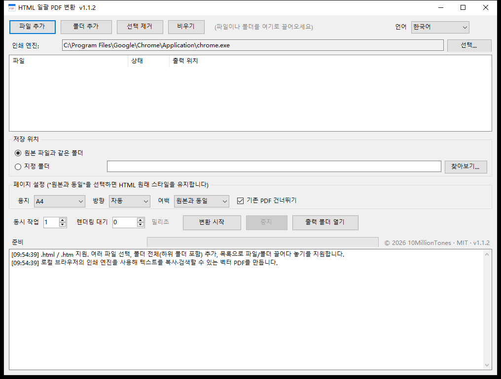

# HTML2PDF

로컬 HTML 파일을 한꺼번에 PDF로 바꿔 주는 Windows 도구입니다. 55 KB짜리 exe 하나, 설치 없이 파일을 넣고 버튼만 누르면 됩니다.

[中文](README.md) | [English](README.en.md) | [日本語](README.ja.md) | **한국어**




## 어떤 도구인가

내보낸 HTML 보고서나 전자 청구서, 오프라인 문서가 쌓여 있어서 한 번에 PDF로 정리해야 할 때가 있습니다. 하나씩 열어 Ctrl+P를 누르는 건 번거롭고, 스크린샷을 이어 붙인 PDF는 글자가 뭉개져서 검색도 되지 않습니다.

이 도구는 PC에 설치된 Chrome / Edge의 인쇄 엔진을 불러 **벡터 PDF**를 한꺼번에 만듭니다. 글자는 복사와 검색이 되고, 레이아웃은 브라우저에서 보던 그대로입니다.

## 기능

- 파일 하나 또는 폴더 전체를 추가하고 `.html` / `.htm`을 하위 폴더까지 검색
- 벡터 PDF 출력, 폰트 서브셋 내장, 글자 선택과 검색 가능
- 화면을 中文 / English / 日本語 / 한국어로 언제든 전환하고, 선택한 언어는 다음 실행에도 유지
- 용지: 원본과 동일, A4, A3, A5, Letter, Legal. 방향은 세로/가로, 여백은 6단계
- 동시 작업 1~4, 기본값 1
- "기존 PDF 건너뛰기", "하위 폴더 포함" 선택 가능
- 한글과 중국어 경로 처리, 같은 이름의 결과물에는 `(2)` 번호가 자동으로 붙음
- 결과물을 임시 파일에 먼저 쓴 뒤 이름을 바꾸므로 중간에 실패해도 반쯤 만들어진 PDF가 남지 않음
- 변환마다 별도의 임시 프로필을 사용해 평소 쓰는 브라우저에 영향 없음
- 작업이 끝나면 임시 파일을 모두 정리

## 다운로드

[Releases](https://github.com/10MillionTones/HTML2PDF/releases/latest)에서 `HTML2PDF.exe`를 받아 더블클릭하면 됩니다. 설치 과정은 없습니다.

## 사용 방법

### 1. 파일 추가

다음 중 아무 방법이나 쓰면 됩니다.

- "파일 추가" 또는 "폴더 추가" 클릭
- 파일이나 폴더를 창으로 끌어다 놓기
- 파일을 exe 아이콘 위로 끌어다 놓기

폴더를 추가할 때 하위 폴더까지 포함할지는 설정을 따릅니다.

### 2. 인쇄 엔진 선택

실행하면 Chrome을 먼저, 그다음 Edge를 자동으로 찾아 "인쇄 엔진"에 경로를 보여 줍니다. 찾지 못했거나 다른 브라우저를 쓰고 싶다면 "선택..."에서 `chrome.exe` / `msedge.exe`를 지정하세요.

### 3. 저장 위치 지정

- **원본 파일과 같은 폴더**: 기본값. PDF가 HTML 옆에 만들어집니다
- **지정 폴더**: 모든 PDF를 한 폴더에 모읍니다

### 4. 페이지 설정

| 항목 | 설명 |
|---|---|
| 용지 | 기본값은 A4. 헤드리스 브라우저의 기본값은 Letter라서 이 설정이 필요합니다 |
| 방향 | 자동 / 세로 / 가로 |
| 여백 | 원본과 동일, 0, 5, 10, 15, 20, 25 mm |
| 기존 PDF 건너뛰기 | 기본값은 켜짐. 끄면 덮어씁니다 |

용지를 지정하면 HTML과 같은 폴더에 임시 복사본을 만들고 `@page` 규칙을 넣어 변환한 뒤 바로 지웁니다. 상대 경로 이미지와 스타일시트가 그대로 로드됩니다.

### 5. 실행 옵션

| 항목 | 기본값 | 설명 |
|---|---|---|
| 동시 작업 | 1 | 동시에 띄우는 브라우저 수. 메모리가 빠듯하면 1로 두세요 |
| 렌더링 대기 | 0 밀리초 | JavaScript로 내용을 나중에 그리는 페이지에만 필요합니다. 예: 2000 |

### 6. 변환 시작

"변환 시작"을 누르면 목록의 상태가 실시간으로 바뀌고 진행 막대와 로그도 함께 갱신됩니다. "중지"는 언제든 누를 수 있고, 이미 끝난 파일은 그대로 남습니다.

### 7. 언어 전환

오른쪽 위 드롭다운에서 중국어, 영어, 일본어, 한국어를 언제든 바꿀 수 있습니다. 버튼과 열 제목, 로그, 대화 상자 문구가 함께 바뀌고 다음 실행에도 그 언어로 시작합니다.

## 자주 묻는 질문

**PDF가 빈 페이지로 나옵니다**

내용을 비동기 요청 뒤에 그리는 페이지일 가능성이 큽니다. "렌더링 대기"를 2000~3000 밀리초로 올려 다시 시도해 보세요.

**"브라우저가 PDF를 만들지 못했습니다"라고 나옵니다**

대괄호 안은 브라우저가 직접 출력한 오류입니다. 흔한 원인은 세 가지입니다. 페이지 스크립트가 인쇄를 막거나, 저장 폴더가 쓰기 불가이거나, 보안 프로그램이 차단한 경우입니다. 바탕 화면 같은 다른 폴더에 저장해 다시 시도해 보세요. 로그에 `Access is denied`가 보이면 권한 문제, `headless` 관련 문구가 보이면 브라우저 버전 문제입니다.

그래도 해결되지 않으면 exe 옆에 `HTML2PDF.log`가 남습니다. 명령줄, 브라우저 버전, 종료 코드, 소요 시간이 기록되어 있으니 이 파일을 보내 주시면 원인을 거의 특정할 수 있습니다.

**로그인이 필요한 페이지는 변환되지 않습니다**

헤드리스 브라우저는 쿠키가 없는 새 환경이라 로그인 상태를 물려받지 못합니다. 이런 페이지는 브라우저에서 직접 저장해야 합니다.

**브라우저를 찾을 수 없다고 나옵니다**

Chrome이나 Edge를 설치하거나 "선택..."에서 브라우저 실행 파일을 직접 지정하세요.

**Windows 7에서 종료되거나 엔진을 쓸 수 없다고 나옵니다**

Chromium 110부터 Windows 7을 지원하지 않습니다. Chrome / Edge 109 이하를 설치하세요.

**백신이 바이러스로 잡습니다**

exe에 디지털 서명이 없어 휴리스틱 탐지에 걸릴 수 있습니다. 예외 목록에 추가하거나 아래 명령으로 직접 빌드하세요.

**용지 크기가 원하는 것과 다릅니다**

"원본과 동일"을 고르면 스타일을 전혀 건드리지 않아 용지가 HTML의 `@page`로 정해집니다. A4로 고정하려면 A4를 선택하세요.

## 실행 환경

| 항목 | 요구 사항 |
|---|---|
| 운영체제 | Windows 7 SP1 / 10 / 11 |
| 아키텍처 | 32비트·64비트 공용 (AnyCPU, 같은 exe) |
| 런타임 | .NET Framework 4.0 이상 (Windows 10 / 11은 4.8 기본 포함) |
| 브라우저 | Chrome 또는 Edge, Windows 7은 109 이하 필요 |

## 동작 원리

브라우저의 헤드리스 인쇄 모드를 호출합니다.

```
chrome.exe --headless --disable-gpu --hide-scrollbars
           --user-data-dir=<임시 프로필>
           --print-to-pdf=<출력>.pdf --no-pdf-header-footer
           "file:///D:/folder/page.html"
```

내부적으로는 `HTML → Blink 레이아웃 → Skia 드로잉 → PDF 객체` 순서로 처리되기 때문에 비트맵이 아닌 실제 벡터와 폰트 서브셋이 들어갑니다. 용지와 여백은 Chrome 명령줄에 해당 인자가 없어서 `@page` CSS를 넣어 지정합니다.

## 프로젝트 구조

```
HTML2PDF.cs      메인 프로그램 (WinForms 단일 파일)
docs/            4개 언어 화면 캡처
LICENSE          MIT 라이선스
README.md        중국어
README.en.md     영어
README.ja.md     일본어
README.ko.md     한국어
```

## 직접 빌드하기

Windows에 기본 포함된 .NET Framework 컴파일러만 있으면 됩니다.

```powershell
C:\Windows\Microsoft.NET\Framework64\v4.0.30319\csc.exe /target:winexe /platform:anycpu /codepage:65001 `
  /out:HTML2PDF.exe /r:System.dll /r:System.Core.dll /r:System.Drawing.dll /r:System.Windows.Forms.dll `
  HTML2PDF.cs
```

## 버전 기록

| 버전 | 내용 |
|---|---|
| 1.1.2 | exe 옆에 HTML2PDF.log 생성. 전체 명령줄, 브라우저 종료 코드, 소요 시간, 브라우저 자체 오류를 기록. 시작 1초 안에 종료되면 별도 안내 표시 |
| 1.1.1 | 실패 시 구체적인 원인 표시(브라우저 로그, 쓰기 불가 폴더, 경로 길이). 임시 파일에 먼저 출력한 뒤 이동하고, 실패하면 최소 옵션으로 한 번 재시도 |
| 1.1.0 | 화면을 중국어·영어·일본어·한국어로 지원. 제목 표시줄에 버전 번호 표시 |
| 1.0.0 | 첫 버전: 일괄 변환, 페이지 설정, 동시 작업, 로그 |

## 라이선스

[MIT License](LICENSE). 사용, 수정, 재배포, 상업적 이용이 모두 자유롭습니다. 저작권 표시만 유지하세요.

Copyright (c) 2026 10MillionTones

## 고지 사항

**저작권**

이 프로젝트의 저작권은 10MillionTones에게 있습니다. MIT 라이선스에 따라 사용, 수정, 재배포 시 `LICENSE` 파일과 소스 및 문서의 저작권 표시를 **반드시 유지**해야 합니다. 저작권 표시를 지우고 재배포하는 것은 라이선스 위반입니다.

**면책**

이 소프트웨어는 "있는 그대로" 제공되며, 상품성, 특정 목적 적합성, 비침해성을 포함한 어떠한 명시적 또는 묵시적 보증도 하지 않습니다. 이 도구를 사용해 발생한 데이터 손실, 내용 오류, 기타 손해에 대해 작성자는 책임지지 않습니다. 변환 결과는 직접 확인하고, 중요한 파일은 원본 HTML을 보관하세요.

**개인정보**

모든 처리는 로컬에서 이루어집니다. 네트워크에 연결하지 않으며 어떤 데이터도 수집하거나 전송하지 않습니다. 변환 중 생긴 임시 파일은 작업이 끝나면 삭제됩니다.

**상표**

Chrome은 Google LLC의 상표, Edge와 Windows는 Microsoft Corporation의 상표입니다. 이 프로젝트는 PC에 설치된 브라우저를 호출할 뿐이며 두 회사와 제휴하거나 보증을 받은 관계가 아닙니다.
