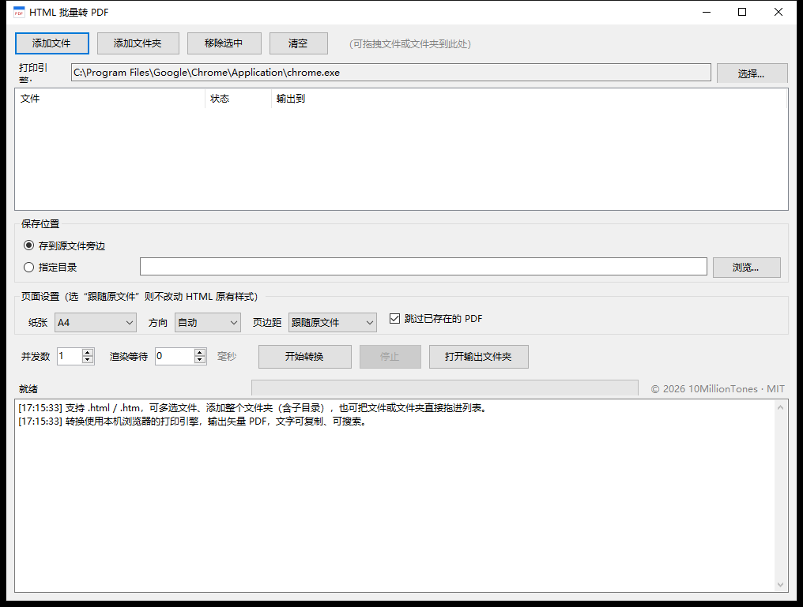

# HTML2PDF

批量把本地 HTML 文件转成 PDF 的 Windows 小工具。一个 35 KB 的 exe，免安装，拖进去点一下就行。




## 它解决什么问题

手上有一堆导出的 HTML 报告、电子发票、离线文档，需要统一转成 PDF 归档或发出去。一个个打开浏览器按 Ctrl+P 太慢，用截图工具拼出来的 PDF 又糊又搜不到字。

这个工具调用本机 Chrome / Edge 的打印引擎，批量输出**矢量 PDF**，文字可以复制和搜索，排版和浏览器里看到的完全一致。

## 功能

- 拖入文件夹或单个文件，递归扫描 `.html` / `.htm`
- 输出矢量 PDF，字体内嵌，文字可复制、可搜索
- 纸张：跟随原文件、A4、A3、Letter、Legal；方向横竖；页边距三档
- 并发 1~4 可调，默认 1
- 可选「跳过已存在的 PDF」「递归子目录」
- 中文路径、同名文件自动加 `(2)` 序号
- 输出先写临时文件再改名，中途失败不会留下半截 PDF
- 每次转换使用独立临时配置目录，不干扰你正在用的浏览器
- 转换结束自动清理所有临时文件

## 下载

到 [Releases](https://github.com/10MillionTones/HTML2PDF/releases/latest) 下载 `HTML2PDF.exe`，双击运行，不用安装。

## 使用说明

### 1. 添加文件

三种方式，任选：

- 点「添加文件」或「添加文件夹」
- 直接把文件、文件夹拖进窗口
- 把文件拖到 exe 图标上

文件夹会按设置决定是否递归子目录。

### 2. 选择打印引擎

程序启动时自动检测，优先 Chrome，其次 Edge，路径显示在「打印引擎」里。检测不到或者你想指定别的浏览器，点「选择...」手动挑一个 `chrome.exe` / `msedge.exe`。

### 3. 设置保存位置

- **存到源文件旁边**：默认，每个 PDF 和它的 HTML 放在一起
- **指定目录**：所有 PDF 统一输出到一个文件夹，保持原有的子目录结构

### 4. 页面设置

| 选项 | 说明 |
|---|---|
| 纸张 | 默认 A4。浏览器的无头模式默认是 Letter，所以这个选项有用 |
| 方向 | 纵向 / 横向 |
| 页边距 | 无 / 窄 / 标准 / 宽 |
| 跟随原文件 | 不注入任何样式，完全按 HTML 自己的 `@page` 和 CSS 输出 |

选了具体纸张时，程序会在 HTML 同目录生成一个临时副本，在里面注入 `@page` 规则，转完立即删除。这样相对路径的图片、样式表还能正常加载。

### 5. 运行参数

| 参数 | 默认 | 说明 |
|---|---|---|
| 并发数 | 1 | 同时开几个浏览器实例。机器内存紧就保持 1 |
| 渲染等待 | 0 毫秒 | 页面内容靠 JS 异步生成时才需要，比如填 2000 |
| 跳过已存在的 PDF | 开 | 关掉则覆盖重转 |

### 6. 开始转换

点「开始转换」，列表里每个文件的状态会实时变化，底部进度条和日志同步更新。随时可以点「停止」，已完成的文件保留。

## 常见问题

**转出来是空白页**

页面内容多半是 JS 异步请求之后才渲染的。把「渲染等待」调到 2000 或 3000 毫秒再试。

**需要登录才能看的页面转不了**

无头浏览器是一个全新的、没有 Cookie 的身份，拿不到你的登录态。这类页面只能在浏览器里手动另存。

**提示找不到浏览器**

装一个 Chrome 或 Edge，或者点「选择...」手动指定浏览器主程序。

**Win7 上闪退或提示引擎不可用**

Chromium 110 起不再支持 Windows 7，需要装 109 或更低版本的 Chrome / Edge。

**杀毒软件报毒**

exe 没有数字签名，容易被启发式引擎误判。把文件加入白名单，或者自己按下面的方法编译一份。

**PDF 纸型不对**

如果选了「跟随原文件」，程序不会改任何样式，纸型由 HTML 自己的 `@page` 决定。想要强制 A4 就选 A4。

## 系统要求

| 项目 | 要求 |
|---|---|
| 系统 | Windows 7 SP1 / 10 / 11 |
| 架构 | 32 位、64 位通用（AnyCPU，同一个 exe） |
| 运行时 | .NET Framework 4.0 以上（Win10 / 11 自带 4.8） |
| 浏览器 | Chrome 或 Edge，Win7 需要 109 或更低版本 |

## 实现原理

调用浏览器的无头打印模式：

```
chrome.exe --headless --disable-gpu --hide-scrollbars
           --user-data-dir=临时配置目录
           --print-to-pdf=输出.pdf --no-pdf-header-footer
           "file:///D:/目录/页面.html"
```

浏览器内部走的是 `HTML → Blink 排版 → Skia 绘制 → PDF 对象` 这条链路，所以输出是矢量图形和真实字体子集，不是位图截图。纸张和页边距通过注入 `@page` CSS 实现，因为 Chrome 命令行没有对应参数。

## 项目结构

```
HTML2PDF.cs   主程序，单文件 WinForms，约 1000 行
docs/         截图等资源
LICENSE       MIT 许可证
README.md     本文件
```

## 自己编译

只需要系统自带的 .NET Framework 编译器：

```powershell
C:\Windows\Microsoft.NET\Framework64\v4.0.30319\csc.exe /target:winexe /platform:anycpu /codepage:65001 `
  /out:HTML2PDF.exe /r:System.dll /r:System.Core.dll /r:System.Drawing.dll /r:System.Windows.Forms.dll `
  HTML2PDF.cs
```

## 许可证

[MIT License](LICENSE)，可自由使用、修改、分发和商用，保留版权声明即可。

Copyright (c) 2026 10MillionTones

## 声明

**版权**

本项目的著作权归 10MillionTones 所有。依据 MIT 许可证，你在使用、修改、再分发时**必须保留** `LICENSE` 文件和源代码、文档中的版权声明。删除版权信息再分发属于违反许可证的行为。

**免责**

软件按「现状」提供，不附带任何明示或暗示的担保，包括但不限于适销性、特定用途适用性和非侵权保证。使用本工具造成的任何数据丢失、内容错误或其他损失，作者不承担责任。转换结果请自行核对，重要文件建议保留原始 HTML。

**隐私**

程序完全在本地运行，不联网、不收集、不上传任何数据。转换过程中的临时文件在结束后删除。

**第三方商标**

Chrome 是 Google LLC 的商标，Edge 和 Windows 是 Microsoft Corporation 的商标。本项目只是调用本机已安装的浏览器，与上述公司没有任何隶属或背书关系。
